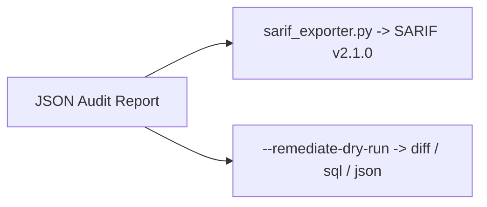

# Tutorial 2: SARIF and Dry-Run Remediation Lab

> **Goal:** Export SARIF v2.1.0 output and preview dry-run remediation in `/tmp/cis-sarif-lab` with zero system edits.

> [!WARNING]
> **Isolated Lab Only:** Store files under `/tmp/cis-sarif-lab`. `--remediate-dry-run` executes zero live commands.



## Prerequisites

- Python `3.8+` checkout of `cis_benchmarks_tools`
- Completed [Tutorial 1: Local & Docker Audit](01-first-local-and-docker-audit.md)

## Step 1: Create a Sample JSON Report

```bash
rm -rf /tmp/cis-sarif-lab && mkdir -p /tmp/cis-sarif-lab
python3 -c 'import json; json.dump({"target":"postgresql16","overall_score":50.0,"results":[{"id":"3.1.2","name":"log_destination","category":"3. Logging","type":"Automated","status":"FAIL","output":"syslog"},{"id":"3.1.20","name":"log_connections","category":"3. Logging","type":"Automated","status":"PASS","output":"on"},{"id":"1.1","name":"packages","category":"1. Install","type":"Manual","status":"MANUAL","remediation":"Review."}]}, open("/tmp/cis-sarif-lab/pg16.json","w"))'
```

## Step 2: Export and Validate SARIF v2.1.0

```bash
python3 -c "import json, sarif_exporter as s; r=json.load(open('/tmp/cis-sarif-lab/pg16.json')); p=s.export_sarif_report(r['results'], r['overall_score'], {}, r['target'], filename='/tmp/cis-sarif-lab/pg16.sarif'); ok, m=s.validate_sarif_document(json.load(open(p))); print(m); assert ok"
```

Expected output: `Valid SARIF v2.1.0 (3 results, 3 rules)`.

## Step 3: Preview Dry-Run Remediation (`diff`, `sql`, `json`)

```bash
python3 audit_cis.py --remediate-dry-run --from-report /tmp/cis-sarif-lab/pg16.json --remediation-format diff --remediation-output /tmp/cis-sarif-lab/fix.diff
python3 audit_cis.py --remediate-dry-run --from-report /tmp/cis-sarif-lab/pg16.json --remediation-format sql
python3 audit_cis.py --remediate-dry-run --from-report /tmp/cis-sarif-lab/pg16.json --remediation-format json | head -n 4
```

## Step 4: Clean Up `/tmp/cis-sarif-lab`

```bash
rm -rf /tmp/cis-sarif-lab
```

## Next Steps

- [How-To Guides](../02-how-to-guides/index.md) · [Reference](../03-reference/index.md) · [Explanation](../04-explanation/index.md)
