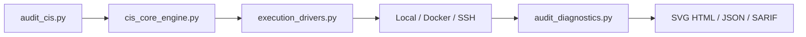

# Four-Tier PSL Audit Architecture

**CIS Benchmarks Tools Suite** (`v2.10.0`) decouples rules, transports, diagnostics, and exporters in 100% Python
Standard Library (`PSL ONLY`).

## Dual-Mode Design & Topology

- **Standalone Scripts**: `audit_cis_*.py` embed fallback rules and inline SVG helpers.
- **Core Delegation**: Checkouts delegate scoring, conditions, and exports to `cis_core_engine.py`.
- **4-Tier Transports**: `execution_drivers.py` routes `LocalExecutor`, `DockerExecutor`, `SSHExecutor`, and
  `RemoteSSHContainerExecutor`.
- **Telemetry & Dry-Run**: `CommandFailureClassifier` isolates env errors; `sarif_exporter.py` emits SARIF v2.1.0;
  `remediation_generator.py` forces `dry_run=True`.

## Credential & Scoring Boundaries

- `CIS_DB_PASSWORD`, `MYSQL_PWD`, and `PGPASSWORD` inject via env (never argv); `SecretSanitizer` scrubs logs.
- `SSHExecutor` rejects `ControlMaster` (`IMP-006`) for Windows safety and concurrency isolation.
- `calculate_scores` excludes `Manual`, `Not Applicable`, and `Error` from $\text{Attempted} = \text{Pass} + \text{Fail}$.

## Related Documentation

- [CLI Flags & Exit Codes](../../03-reference/cli-and-scripts/cli-flags-and-exit-codes.md) · [Targets & Scoring](../../03-reference/configuration/targets-and-transport-matrix.md)
- [Remote Audits](../../02-how-to-guides/deployment/run-remote-ssh-and-docker-audits.md) · [SARIF CI](../../02-how-to-guides/operations/integrate-sarif-and-remediation-ci.md)
