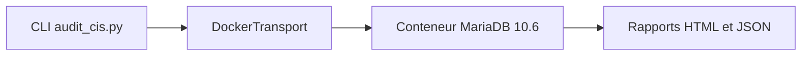

# Tutoriel 1 : Premier audit local et Docker

Ce tutoriel guidé exécute votre premier audit CIS sur un conteneur Docker éphémère puis génère un rapport HTML et JSON hors ligne.



## Prérequis isolés

- Python `3.10` ou supérieur installé (`python3 --version`).
- Docker Engine actif sur la station de test.
- Dépôt cloné avec `audit_cis.py` disponible à la racine.

## Étape 1 — Lister les cibles supportées

Affichez l'aide CLI et la liste des 18 cibles CIS intégrées :

```bash
python3 audit_cis.py --help
python3 audit_cis.py --list-targets
```

Résultat attendu : `audit_cis.py` affiche l'en-tête `Supported CIS Audit Targets (18 Benchmarks / 887 Controls)` puis les colonnes `Target Key`, `Name`, `Controls` et `Script File` (`mariadb106` à `rhel10`) sans dépendance externe.

## Étape 2 — Démarrer un conteneur MariaDB 10.6 éphémère

Créez un répertoire temporaire dédié et démarrez le conteneur de laboratoire :

```bash
mkdir -p /tmp/cis-tut-fr
docker run -d --name cis-tut-mariadb \
  -e MARIADB_ALLOW_EMPTY_ROOT_PASSWORD=yes \
  mariadb:10.6
sleep 8
```

## Étape 3 — Lancer l'audit Docker en HTML et JSON

Exécutez l'audit CIS MariaDB 10.6 v1.1.0 sur le conteneur cible pour les sorties HTML et JSON :

```bash
python3 audit_cis.py -t mariadb106 -c cis-tut-mariadb -l fr \
  -f html -o /tmp/cis-tut-fr/mariadb106.html
python3 audit_cis.py -t mariadb106 -c cis-tut-mariadb -l fr \
  -f json -o /tmp/cis-tut-fr/mariadb106.json
```

Résultat attendu :
- Un rapport autonome `/tmp/cis-tut-fr/mariadb106.html` contenant les graphiques SVG hors ligne.
- Un résumé structuré `/tmp/cis-tut-fr/mariadb106.json` utilisable hors ligne en CI.

## Nettoyage

Supprimez uniquement les ressources créées pour ce tutoriel :

```bash
if command -v docker >/dev/null 2>&1; then
  docker rm -f cis-tut-mariadb
fi
rm -rf /tmp/cis-tut-fr
```

## Aller plus loin

- Continuez avec le [Tutoriel 2 — Lab SARIF et remédiation dry-run](02-lab-sarif-et-remediation.md).
- Consultez les [Guides pratiques](../02-guides-pratiques/index.md), la [Référence](../03-reference/index.md) et l'[Architecture 4 couches](../04-explications/index.md).
- Retour à l'[Accueil FR](../index.md).
