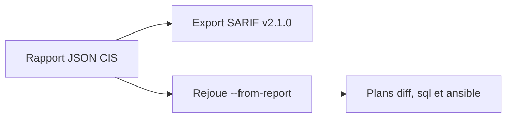

# Tutoriel 2 : Lab SARIF et remédiation dry-run

Ce tutoriel produit un export SARIF v2.1.0 et génère des plans de remédiation déterministes en lecture seule à partir d'un rapport JSON existant.



## Prérequis isolés

- Python `3.10` ou supérieur (`python3 --version`).
- Avoir terminé le [Tutoriel 1](01-premier-audit-local-et-docker.md) ou disposer du répertoire du projet.

## Étape 1 — Préparer un rapport JSON de démonstration

Créez un espace temporaire et un exemple minimal de rapport JSON :

```bash
mkdir -p /tmp/cis-sarif-fr
cat <<'EOF' > /tmp/cis-sarif-fr/sample_report.json
{
  "target": "mariadb106",
  "version": "1.1.0",
  "host": "tut-mariadb",
  "timestamp": "2026-11-24T00:00:00Z",
  "controls": [
    {
      "id": "4.3",
      "title": "Ensure allow-nonexistent-definer is OFF",
      "status": "FAIL",
      "severity": "HIGH",
      "remediation": "SET GLOBAL local_infile = OFF;"
    }
  ]
}
EOF
```

## Étape 2 — Générer un plan de remédiation dry-run

Rejouez le rapport hors ligne avec `--remediate-dry-run` :

```bash
python3 audit_cis.py --remediate-dry-run \
  --from-report /tmp/cis-sarif-fr/sample_report.json \
  --remediation-format diff \
  --remediation-output /tmp/cis-sarif-fr/plan.diff
```

Résultat attendu : `plan.diff` contient le plan de modification sans aucune exécution sur une base réelle. Changez `--remediation-format` pour `sql`, `shell`, `ansible` ou `json` selon votre outillage.

## Étape 3 — Générer et valider le format SARIF v2.1.0

Convertissez le rapport JSON en document SARIF v2.1.0 et vérifiez ses invariants :

```bash
python3 -c "import json, sarif_exporter; data = json.load(open('/tmp/cis-sarif-fr/sample_report.json', encoding='utf-8')); doc = sarif_exporter.build_sarif_document(data['controls'], target_name=data['target']); ok, msg = sarif_exporter.validate_sarif_document(doc); assert ok, msg; sarif_exporter.export_sarif_report(data['controls'], 0.0, {}, data['target'], '/tmp/cis-sarif-fr/report.sarif'); print(msg)"
```

Résultat attendu : `SARIF Report generated: /tmp/cis-sarif-fr/report.sarif` puis `Valid SARIF v2.1.0 (1 results, 1 rules)`.

## Nettoyage

```bash
rm -rf /tmp/cis-sarif-fr
```

## Aller plus loin

- Consultez les [Guides pratiques](../02-guides-pratiques/index.md) pour intégrer SARIF dans GitHub Actions.
- Vérifiez les options exactes dans la [Référence](../03-reference/index.md) et l'[Architecture PSL](../04-explications/index.md).
- Retour à l'[Accueil FR](../index.md).
