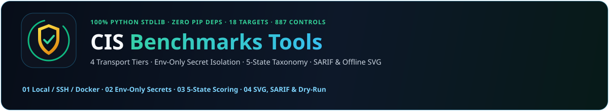

# CIS Benchmarks Tools Suite (v2.10.0)

Zero-dependency security compliance audit suite (`PSL ONLY`). Live portal:
[https://cis-benchmarks.lightpath.fr/](https://cis-benchmarks.lightpath.fr/).

  
18 Targets / 887 ControlsMariaDB, MySQL, PG, Mongo, Cassandra, RHEL

  
100% Python PSLZero pip · Inline SVG

  
4 Transport TiersLocal · Docker · SSH · SSH Docker

  
5-State + SARIFSARIF v2.1.0 · Dry-Run Fix

[Start Tutorials](01-tutorials/index.md){ .md-button .md-button--primary }
[How-To Guides](02-how-to-guides/index.md){ .md-button }
[Reference](03-reference/index.md){ .md-button }
[Explanation](04-explanation/index.md){ .md-button }

---

## Diátaxis Matrix (Action × Cognition)

| | **Practical (Action)** | **Theoretical (Cognition)** |
| :--- | :--- | :--- |
| **Acquisition (Study)** | [**1. Tutorials**](01-tutorials/index.md) Local, Docker, SARIF, dry-run labs | [**4. Explanation**](04-explanation/index.md) 4-tier PSL architecture and ADRs |
| **Application (Work)** | [**2. How-To Guides**](02-how-to-guides/index.md) ASD-STE100 ops and triage SOPs | [**3. Reference**](03-reference/index.md) CLI flags, 18 targets, error matrix |

---

## Explore Documentation by Quadrant

-   :material-school-outline:{ .lg .middle } **1. Tutorials (`01-tutorials/`)**

    ---

    Isolated labs for local/Docker audits, SARIF, and dry-run fixes.

    - [Tutorials Index](01-tutorials/index.md)
    - [Tutorial 1: Local & Docker Audit](01-tutorials/01-first-local-and-docker-audit.md)
    - [Tutorial 2: SARIF & Dry-Run Lab](01-tutorials/02-sarif-and-dry-run-remediation-lab.md)

-   :material-wrench-outline:{ .lg .middle } **2. How-To Guides (`02-how-to-guides/`)**

    ---

    ASD-STE100 Issue 9 operations, triage, and security procedures.

    - [How-To Guides Index](02-how-to-guides/index.md)
    - [Remote SSH & Docker Audits](02-how-to-guides/deployment/run-remote-ssh-and-docker-audits.md)
    - [SARIF & Dry-Run Remediation CI](02-how-to-guides/operations/integrate-sarif-and-remediation-ci.md)
    - [Triage Errors & Auth Failures](02-how-to-guides/incident-response/triage-audit-errors-and-auth-failures.md)
    - [Protect Credentials & MCP Presets](02-how-to-guides/security/protect-credentials-and-run-mcp-presets.md)
    - [Publishing](PUBLISHING.md) · [MCP Contract](MCP_API_EXECUTOR_CONTRACT.md)

-   :material-table-search:{ .lg .middle } **3. Reference (`03-reference/`)**

    ---

    CLI flags, 18 targets, 5 states, and failure classifiers.

    - [Reference Index](03-reference/index.md)
    - [CLI Flags & Exit Codes](03-reference/cli-and-scripts/cli-flags-and-exit-codes.md)
    - [Targets & Transport Matrix](03-reference/configuration/targets-and-transport-matrix.md)
    - [Error & Alert Matrix](03-reference/troubleshooting-codes/error-and-alert-matrix.md)
    - [Targets Spec](../documentation/specifications/benchmark-targets.md) · [Metrics Spec](../documentation/specifications/reporting-and-metrics.md)

-   :material-lightbulb-outline:{ .lg .middle } **4. Explanation (`04-explanation/`)**

    ---

    PSL rationale, 4-tier transport model, and ADRs.

    - [Explanation Index](04-explanation/index.md)
    - [Architecture Spec](../documentation/specifications/architecture.md) · [Transports Spec](../documentation/specifications/execution-contexts.md)

-   :material-translate:{ .lg .middle } **Overviews & Specs**

    ---

    Bilingual overviews and QA governance specs.

    - [README EN](../README.md) · [FR](../README_fr.md)
    - [Governance](../documentation/specifications/project-governance.md) · [QA](../documentation/specifications/testing-and-quality-assurance.md)

-   :material-history:{ .lg .middle } **Releases & Governance**

    ---

    Releases, roadmap, registers, and [cis-benchmarks.lightpath.fr](https://cis-benchmarks.lightpath.fr/).

    - [Release `v2.10.0`](RELEASE_NOTES_v2.10.0.md) · [Roadmap](../ROADMAP.md)
    - [Action Logbook](ACTION_LOGBOOK.md) · [RCA Register](RCA_REGISTER.md)

